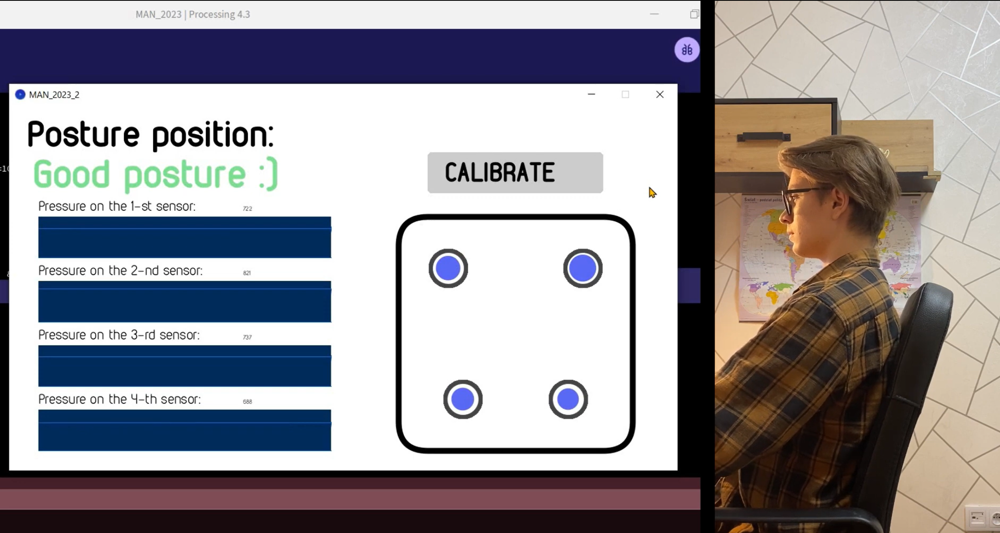
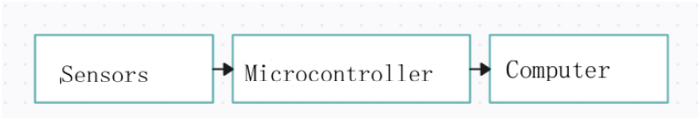
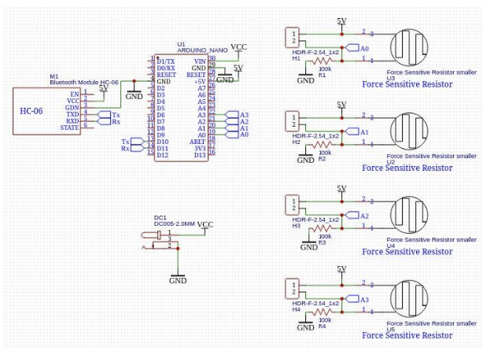
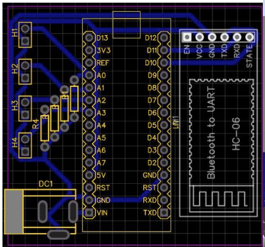
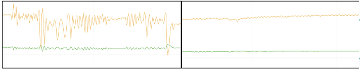
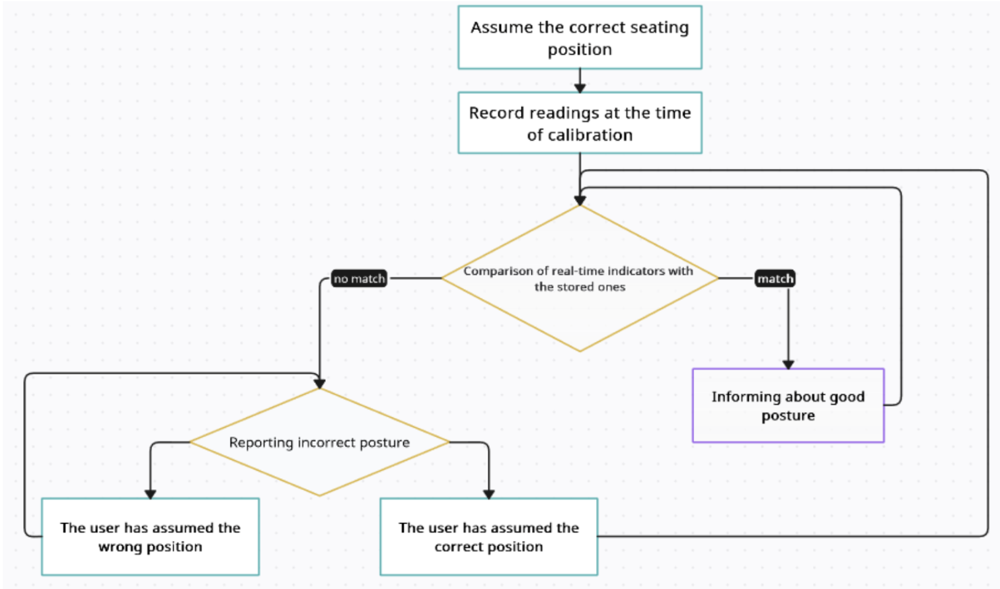
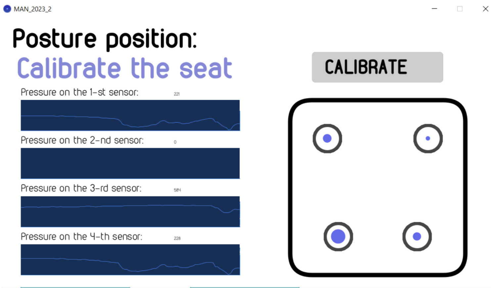
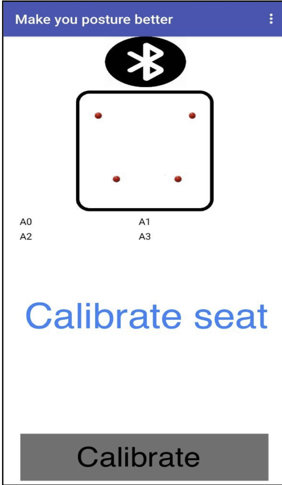

# DEVELOPMENT-OF-A-HARDWARE-AND-SOFTWARE-SYSTEM-FOR-POSTURE-CORRECTNESS-DETECTION (v1)

A hardware and software system that detects incorrect sitting posture using four force-sensitive resistors under a chair pad. It streams the readings to a PC (USB) or an Android phone (Bluetooth), shows them live, and alerts the user when the posture drifts away from a personal calibration.

> **Status:** v1, school research project, working prototype.
> Participated in the competition of the National Center "Junior Academy of Sciences of Ukraine" (JASU) under the auspices of UNESCO, and received feedback at the
> - I-FEST 2024 in Republic of Tunisia – 2nd place in nomination “Engineering”;
> - InventorUA  in Ukraine - 2nd place in nomination “Maintaining health and treating diseases”;
> -INTARG in Poland - 1st place in category “Young inventor”
> - 3rd place at the final stage of the All-Ukrainian Competition – defence of research works of students – members of the Junior Academy of Sciences of Ukraine
> - INOVA 2024 in Croatia - 1st place 




## Why this project

Many people sit for hours at a desk. Orthopaedic chairs do not measure posture, and wearable correctors are uncomfortable. The goal was a low-cost pad that works on any chair, measures where the weight is on the seat, and warns the user when they slouch.

## What it does

- Measures pressure at four points of the seat (four quadrants).
- Computes the centre of mass of the load and compares it with a **per-user calibration**, so body size, gender and existing posture problems do not need a global model.
- Filters the signal (averaging + median filter) to suppress random disturbances.
- PC application (Processing): live sensor graphs, a visual model of the pad, text and sound alerts, a **30-minute warm-up reminder**.
- Android application (MIT App Inventor) over Bluetooth: posture status, notifications, calibration.
- Standalone battery-powered device on a custom PCB.

## System overview

```
FSR 402 x4 --> voltage dividers --> Arduino Nano (ATmega328P)
                                         |  ADC, averaging, centre of mass, median filter
                      +------------------+------------------+
                      | USB serial (9600)                   | HC-05 Bluetooth SPP (9600)
                      v                                     v
              PC app (Processing)                  Android app (App Inventor)
```



## Hardware

| Part | Details |
|---|---|
| Sensors | 4 × FSR 402 force-sensing resistors (18.28 mm), each in a voltage divider with a fixed resistor |
| MCU | Arduino Nano (ATmega328P), 10-bit ADC |
| Wireless | HC-05 Bluetooth SPP module (2.4 GHz, up to ~10 m) |
| Power | Rechargeable Li-ion cells with a charge/discharge controller |
| Mechanics | Two layers of 5 mm rubber (32 × 32 cm); each sensor sits in a "sandwich" of two plywood squares and a rubber layer |
| PCB | Designed in EasyEDA, manufactured on copper-clad laminate by the laser-iron (toner transfer) method, hand-drilled, soldered |

Analog inputs used in the published firmware: `A0`, `A2`, `A5`, `A7`. HC-05 is connected through `SoftwareSerial` on pins 10 (RX) and 11 (TX).

Schematic and PCB: see [`hardware/`](hardware/).




### Design iterations (what went wrong and how it was fixed)

1. **Sensor placement.** The first layout put each sensor directly on the rubber. Small user movements caused large readout errors. **Fix:** a quadrant "sandwich" (plywood + rubber + sensor + plywood) that spreads the load per sensor and compensates for seat irregularities.
2. **Op-amp front end.** An operational-amplifier stage did not give satisfactory results and was removed.
3. **Readings too high.** Fixed by using lower-value fixed resistors in the dividers.
4. **Cross-platform use.** Added the HC-05 Bluetooth module so a phone can be used instead of a PC.



## Algorithm

1. The firmware reads the four ADC channels and averages **60 samples** per channel.
2. Each sensor value is placed in one quadrant of a coordinate grid, with the sign depending on the quadrant (Q1 `(+,+)`, Q2 `(−,+)`, Q3 `(−,−)`, Q4 `(+,−)`).
3. The centre of mass is computed along each diagonal (Q1–Q3 and Q2–Q4) as a pressure-weighted average, and the two results are averaged into one point `(centerX, centerY)`.
4. A **median filter over the last three values** (ring buffer of 3) removes spikes.
5. The user sits in the correct position and presses **CALIBRATE**; the PC app stores that centre-of-mass point as the reference.
6. If the deviation from the reference exceeds **80 %** of the reference position within a given time window, the app shows a warning and plays a sound. When the user corrects the posture, the warning stops.



### Serial data format

One line per update, 9600 baud.

| Link | Separator | Fields (in this order) |
|---|---|---|
| USB | space | `sensor2 sensor1 sensor3 sensor4 centerX centerY` |
| Bluetooth | `\|` | `sensor2\|sensor1\|sensor3\|sensor4\|centerX\|centerY` |

`sensor1`–`sensor4` are the averaged ADC readings, `centerX/centerY` are the filtered centre-of-mass coordinates.

## Software

| Component | Tech | Folder |
|---|---|---|
| Firmware | C/C++ (Arduino framework, AVR-GCC) | [`firmware/`](firmware/) |
| PC application | Processing (Java), `controlP5`, `processing.serial`, `processing.sound`, `javax.swing` | [`pc-app/`](pc-app/) |
| Android application | MIT App Inventor | [`mobile-app/`](mobile-app/) |

PC application states: `Calibrate seat`, `Good posture :)`, `Sit up straighter on the seat :|`, `Sit on the seat`.




## Build and run

1. **Firmware:** open `firmware/posture_firmware/posture_firmware.ino` in the Arduino IDE, select *Arduino Nano*, upload.
2. **PC app:** install Processing, add the libraries `controlP5` and `Sound` (Contribution Manager), open `pc-app/`, set the correct serial port in the sketch, run.
3. **Android app:** import `mobile-app/posture-monitor.aia` in MIT App Inventor, pair the HC-05 with your phone, run.

## Known limitations (v1)

- The firmware is written with Arduino-level abstractions (`analogRead`, `SoftwareSerial`, `String`) and blocking delays; there is no use of hardware timers or interrupts.
- Averaging is a 60-sample block average with a fixed delay, not a true sliding window.
- One channel is scaled empirically in firmware (`analogRead(5) / 2`) to match the others.
- Calibration is manual and user-dependent. The system has been tested on a few people in a lab setting only; there is **no clinical validation** and no quantitative accuracy study.
- Signal-quality comparison between the two mechanical constructions is qualitative (see the graph above).

## Roadmap (v2, planned)

- Move the filters and centre-of-mass computation into a plain C module and unit-test it on the PC.
- Bare-metal firmware: timer-driven sampling, interrupt-based UART with a ring buffer, no `String`, measured RAM/flash use.
- Fixed-point arithmetic instead of floating point.
- Log data with a reference to measure detection accuracy.
- Vibration motor for tactile feedback; Bluetooth Low Energy.
- Artificial intelligence / machine learning:
  - Collect a labelled dataset of pressure readings from different users and postures (upright, leaning left/right, leaning forward, slouching, seat empty).
  - Train a small classifier (for example a decision tree or a compact neural network) and compare it with the current threshold-based detection.
  - Run the model efficiently, either on the phone or on the microcontroller (TinyML), keeping the memory and latency constraints in mind.
  - Use the model for personalised posture recommendations instead of a single fixed threshold.

## Repository structure

```
posture-monitor-v1/
├── README.md
├── LICENSE
├── firmware/posture_firmware/posture_firmware.ino
├── pc-app/                    # Processing sketch (+ data/ with the alert sound)
├── mobile-app/                # posture-monitor.aia + screenshots of the blocks
├── hardware/                  # schematic, PCB, 3D view, (optional) Gerber, BOM
└── docs/images/               # photos, diagrams, graphs
```

## License

GPL-3.0, Commercial licensing available on request. The FSR 402 datasheet is not included; see the manufacturer's page.

## Author and supervisor

- Illia Andrushko — author. Electronic and Computer Engineering, Dublin City University.
- Vitaliy Diduk (Дідук Віталій Андрійович) — scientific supervisor. Head of the Department of Automation and Computer-Integrated Technologies, Institute of Information and Educational Technologies, Bohdan Khmelnytsky National University of Cherkasy; Candidate of Technical Sciences (PhD equivalent), Associate Professor.
